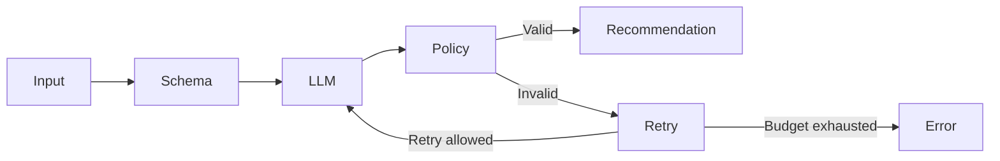

# Applied LLM Engineering & Safety — Conceptual architecture

This is a sanitized conceptual view, not an exact deployment topology or a verified runtime trace.

## Design boundary
Python, OpenAI Responses API, Pydantic contracts and deterministic policy validation.

## Validation boundary
Small synthetic sample; confidence is not calibrated; no formal verification or production impact claim.

## Engineering interpretation
Separate probabilistic generation from deterministic acceptance. Invalid outputs receive a bounded retry; unresolved cases return structured errors. Human review is a recommendation, not an implemented approval workflow.
