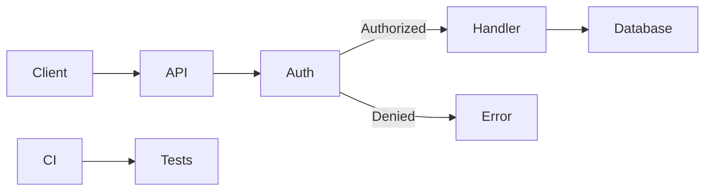

# Backend & Cloud Engineering — Conceptual architecture

This is a sanitized conceptual view, not an exact deployment topology or a verified runtime trace.

## Design boundary
Flask, SQLAlchemy, PostgreSQL, JWT, Docker Compose and GitHub Actions.

## Validation boundary
Tests use SQLite; PostgreSQL integration, deployment scale and Kubernetes are not independently verified.

## Engineering interpretation
Enforce authorization in the API and integrity in the relational model. Container configuration supports repeatable local setup; CI runs tests, not deployment.
