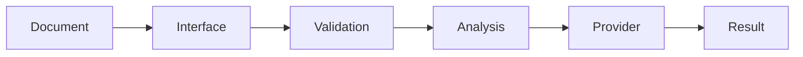

# Intelligent Document Processing — Conceptual architecture

This is a sanitized conceptual view, not an exact deployment topology or a verified runtime trace.

## Design boundary
React and TypeScript interface with serverless LLM integration and document-processing dependencies.

## Validation boundary
Extraction accuracy, privacy controls, external-data freshness and authentication enforcement need validation.

## Engineering interpretation
Validate input before model invocation. Treat document text as untrusted and distinguish generated analysis from verified facts. The latter safeguards are proposed, not demonstrated.
