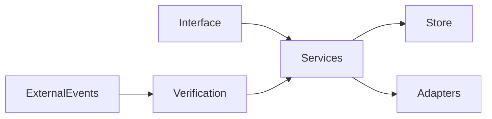

# Enterprise AI & Fintech — Conceptual architecture

This is a sanitized conceptual view, not an exact deployment topology or a verified runtime trace.

## Design boundary
Serverless TypeScript services, relational persistence, authenticated workflows, voice AI and payment integrations.

## Validation boundary
Tenant isolation, concurrency, operational reliability and business outcomes remain unverified.

## Engineering interpretation
Separate authenticated application workflows from external event ingestion. Signature verification and duplicate detection are observed; atomic idempotency and tenant isolation are not established.
