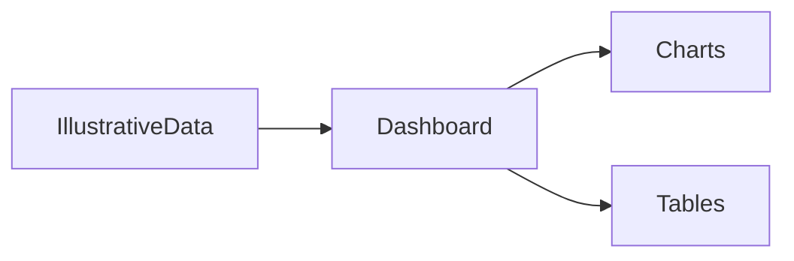

# Enterprise Analytics — Conceptual architecture

This is a sanitized conceptual view, not an exact deployment topology or a verified runtime trace.

## Design boundary
React, TypeScript, Vite and charting dependencies; analytics and transaction-oriented pages.

## Validation boundary
Live data integration, KPI correctness, accessibility and performance are unverified.

## Engineering interpretation
Separate presentation from data contracts as a proposed design principle. Only interface structure and chart dependencies were observed.
