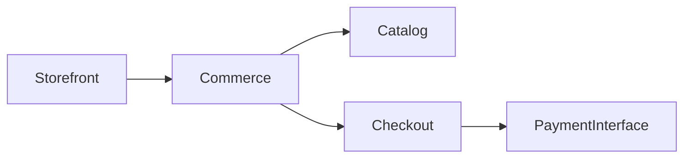

# E-commerce & Legacy Integration — Conceptual architecture

This is a sanitized conceptual view, not an exact deployment topology or a verified runtime trace.

## Design boundary
PHP application structure with checkout, catalog, shipping and payment-related modules.

## Validation boundary
Module behavior, original authorship, modernization outcomes and integration reliability are unverified.

## Engineering interpretation
Use module boundaries as a starting hypothesis for dependency discovery; no migration or equivalence testing has been demonstrated.
